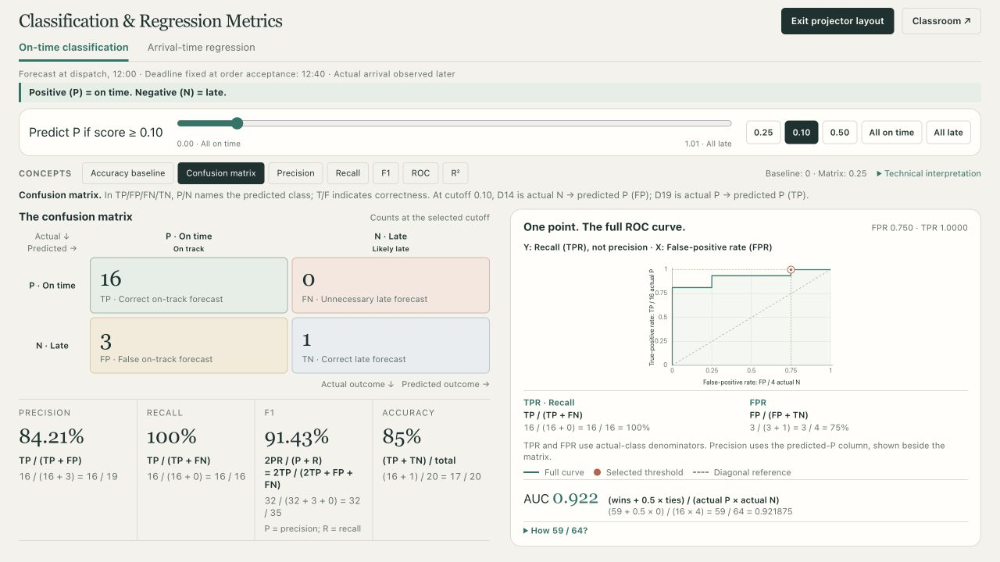

# ML Learning Lab

Interactive playgrounds for understanding machine learning through visible calculations, experiments, and Python.

**[Explore the learning labs](https://sharanharsoor.github.io/ml-learning-lab/)** · **[Open Classification & Regression Metrics](https://sharanharsoor.github.io/ml-learning-lab/classification-regression-metrics/)** · **[Open Decision Trees](https://sharanharsoor.github.io/ml-learning-lab/decision-trees/)**

## Available labs

### Classification & Regression Metrics

An interactive lesson connecting predictions, outcomes, error measures, and model evaluation.

- Change a classification cutoff and inspect the confusion matrix, precision, recall, F1, and accuracy.
- Explore ROC operating points and select individual score pairs to understand ROC-AUC.
- Compare MAE, MSE, RMSE, and R² using the same delivery-duration examples.
- Use the drawing board and classroom questions to explain the ideas with learners.
- Run the accompanying notebooks to verify the calculations in Python.

[Open the playground](https://sharanharsoor.github.io/ml-learning-lab/classification-regression-metrics/) · [Python notebooks](labs/classification-regression-metrics/notebooks/) · [Instructor guide](labs/classification-regression-metrics/INSTRUCTOR_GUIDE.md)



The classification and delivery examples are synthetic teaching data. Scores illustrate rankings and are not demonstrated calibrated probabilities. The optional trained-model notebook uses the attributed UCI Wine Quality dataset.

### Decision Trees

Teach a full decision-tree lesson with one fictional parcel-sorting dataset. Follow the guided chapters or turn on Teaching view to use larger text and chapter controls while screen-sharing.

- Build entropy from inverse probability and average surprise, then compare it with Gini.
- Rank exact and binned split candidates, grow the tree, and inspect the held-out confusion matrix.
- Attribute split gains to features and switch to mean squared error for a numerical target.
- Run Python in the browser to verify the calculations.

[Open the playground](https://sharanharsoor.github.io/ml-learning-lab/decision-trees/) · [Instructor guide](labs/decision-trees/INSTRUCTOR_GUIDE.md)

## Run the website locally

The committed website needs no package installation, account, API key, or backend.

```bash
python3 -m http.server 8000 --directory docs
```

Open [http://localhost:8000/](http://localhost:8000/). The lab can also save a self-contained offline HTML copy and export its notebooks and datasets.

## Run the Python examples

From the repository root:

```bash
python3 -m venv .venv
source .venv/bin/activate
python -m pip install -r labs/classification-regression-metrics/requirements.txt
python -m jupyterlab
```

On Windows, activate with `.venv\Scripts\activate` instead. Open `labs/classification-regression-metrics/notebooks/metrics_core.ipynb` and run it from the beginning. `metrics_public_data.ipynb` is an optional exercise using fitted models and the bundled public dataset.

## Build and verify

Python 3 builds the static pages using only the standard library. Node.js 18 or newer runs the metrics checks without npm packages.

```bash
python3 scripts/build_site.py
node labs/classification-regression-metrics/tests/check_metrics.mjs
node labs/decision-trees/tests/check_tree.mjs
python3 scripts/build_site.py --check
```

The checks cover 106 classification cutoffs, confusion-matrix highlights, all 64 AUC score pairs, pair selection, a separate tie fixture, and five regression examples with live formulas and input bounds. The decision-tree checks independently verify split candidates, impurity, stopping rules, held-out predictions, and feature importance.

GitHub Pages publishes the committed `docs/` directory from `main`. After changing a lab, rebuild, run its checks, and commit the generated pages with the source changes.

## Add another concept

Each lab lives in `labs/<concept-slug>/` and is published at `/<concept-slug>/` within the collection. The homepage is generated from the lab manifests, so a new topic does not require renaming the repository or replacing another playground.

See [CONTRIBUTING.md](CONTRIBUTING.md) for the folder layout and build interface.

## License and attribution

Original application code, documentation, and synthetic teaching examples are available under the [MIT License](LICENSE). Third-party datasets retain their own licenses. The UCI Wine Quality files are CC BY 4.0; see the lab's [third-party notices](labs/classification-regression-metrics/THIRD_PARTY_NOTICES.md).
